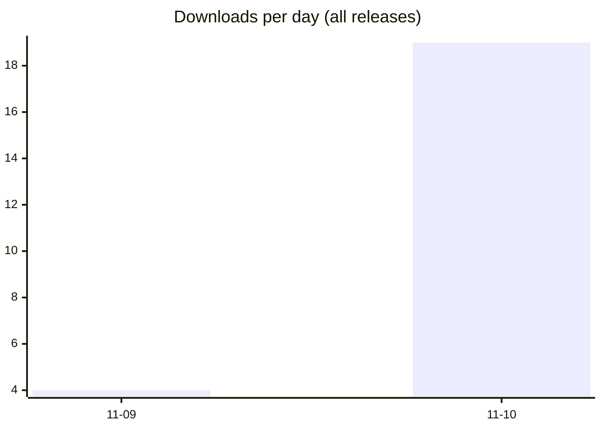
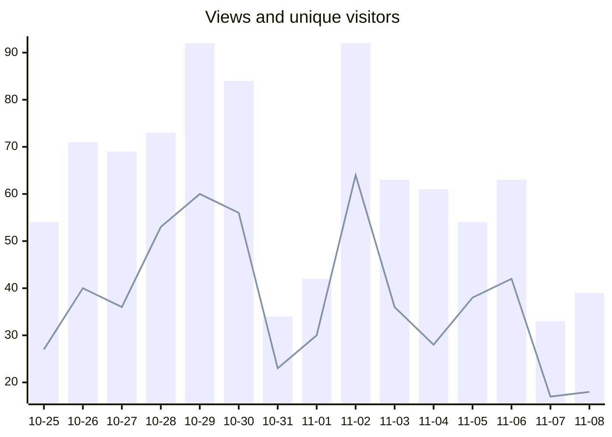

# Live-translation: statistics

Updated 2026-11-10 by the daily *Repository statistics* workflow (`.github/workflows/stats.yml` on the default branch). The figures are kept in [`data/`](data/) as CSV files, one row per day, for a spreadsheet or a dashboard.

| Downloads, versions | Downloads, all releases | Views, last 14 days |
| ---: | ---: | ---: |
| 662 | 662 | 730 |

## Downloads per version

Every file of a release counts once each time it is downloaded from GitHub. "…" means the history does not go back that far yet.

| Release | Published | Downloads | Last 7 days | Last 30 days |
| --- | --- | ---: | ---: | ---: |
| [v1.12.0](https://github.com/fmadore/Live-translation/releases/tag/v1.12.0) | 2026-10-27 | 174 | … | 174 |
| [v1.11.0](https://github.com/fmadore/Live-translation/releases/tag/v1.11.0) | 2026-10-26 | 32 | … | 32 |
| [v1.10.0](https://github.com/fmadore/Live-translation/releases/tag/v1.10.0) | 2026-10-26 | 2 | … | 2 |
| [v1.9.0](https://github.com/fmadore/Live-translation/releases/tag/v1.9.0) | 2026-10-22 | 56 | … | 56 |
| [v1.8.0](https://github.com/fmadore/Live-translation/releases/tag/v1.8.0) | 2026-10-21 | 28 | … | 28 |
| [v1.7.1](https://github.com/fmadore/Live-translation/releases/tag/v1.7.1) | 2026-10-20 | 32 | … | 32 |
| [v1.7.0](https://github.com/fmadore/Live-translation/releases/tag/v1.7.0) | 2026-10-20 | 6 | … | 6 |
| [v1.6.1](https://github.com/fmadore/Live-translation/releases/tag/v1.6.1) | 2026-10-06 | 227 | … | … |
| [v1.6.0](https://github.com/fmadore/Live-translation/releases/tag/v1.6.0) | 2026-10-04 | 14 | … | … |
| [v1.5.1](https://github.com/fmadore/Live-translation/releases/tag/v1.5.1) | 2026-09-23 | 18 | … | … |
| [v1.5.0](https://github.com/fmadore/Live-translation/releases/tag/v1.5.0) | 2026-09-22 | 6 | … | … |
| [v1.4.2](https://github.com/fmadore/Live-translation/releases/tag/v1.4.2) | 2026-09-21 | 6 | … | … |
| [v1.4.1](https://github.com/fmadore/Live-translation/releases/tag/v1.4.1) | 2026-09-20 | 7 | … | … |
| [v1.4.0](https://github.com/fmadore/Live-translation/releases/tag/v1.4.0) | 2026-09-19 | 6 | … | … |
| [v1.3.0](https://github.com/fmadore/Live-translation/releases/tag/v1.3.0) | 2026-09-19 | 8 | … | … |
| [v1.2.4](https://github.com/fmadore/Live-translation/releases/tag/v1.2.4) | 2026-09-14 | 2 | … | … |
| [v1.2.3](https://github.com/fmadore/Live-translation/releases/tag/v1.2.3) | 2026-09-08 | 4 | … | … |
| [v1.2.2](https://github.com/fmadore/Live-translation/releases/tag/v1.2.2) | 2026-09-08 | 4 | … | … |
| [v1.1.0](https://github.com/fmadore/Live-translation/releases/tag/v1.1.0) | 2026-08-27 | 8 | … | … |
| [v1.0.5](https://github.com/fmadore/Live-translation/releases/tag/v1.0.5) | 2026-08-26 | 0 | … | … |
| [v1.0.0](https://github.com/fmadore/Live-translation/releases/tag/v1.0.0) | 2026-08-21 | 5 | … | … |
| [v0.6.0](https://github.com/fmadore/Live-translation/releases/tag/v0.6.0) | 2026-08-20 | 1 | … | … |
| [v0.5.3](https://github.com/fmadore/Live-translation/releases/tag/v0.5.3) | 2026-08-12 | 3 | … | … |
| [v0.5.2](https://github.com/fmadore/Live-translation/releases/tag/v0.5.2) | 2026-08-12 | 1 | … | … |
| [v0.5.1](https://github.com/fmadore/Live-translation/releases/tag/v0.5.1) | 2026-08-07 | 1 | … | … |
| [v0.5.0](https://github.com/fmadore/Live-translation/releases/tag/v0.5.0) | 2026-08-07 | 1 | … | … |
| [v0.4.0](https://github.com/fmadore/Live-translation/releases/tag/v0.4.0) | 2026-08-01 | 1 | … | … |
| [v0.3.0](https://github.com/fmadore/Live-translation/releases/tag/v0.3.0) | 2026-07-28 | 0 | … | … |
| [v0.2.3](https://github.com/fmadore/Live-translation/releases/tag/v0.2.3) | 2026-06-30 | 2 | … | … |
| [v0.2.2](https://github.com/fmadore/Live-translation/releases/tag/v0.2.2) | 2026-06-30 | 4 | … | … |
| [v0.2.1](https://github.com/fmadore/Live-translation/releases/tag/v0.2.1) | 2026-06-30 | 1 | … | … |
| [v0.2.0](https://github.com/fmadore/Live-translation/releases/tag/v0.2.0) | 2026-06-29 | 1 | … | … |
| [v0.1.1](https://github.com/fmadore/Live-translation/releases/tag/v0.1.1) | 2026-06-18 | 1 | … | … |
| [v0.1.0](https://github.com/fmadore/Live-translation/releases/tag/v0.1.0) | 2026-06-17 | 0 | … | … |

## Downloads per day, last 60 days

## Files of v1.12.0

| File | Downloads |
| --- | ---: |
| Live.Translation_1.12.0_x64-setup.exe | 135 |
| Live.Translation_1.12.0.msixbundle | 18 |
| Live.Translation_1.12.0_x64_en-US.msi | 9 |
| Live.Translation_1.12.0_arm64.msix | 6 |
| Live.Translation_1.12.0_x64.msix | 6 |

## Visits to the repository, last 60 days

Bars are views, the line unique visitors (GitHub's daily figures, UTC; today is still counting).

