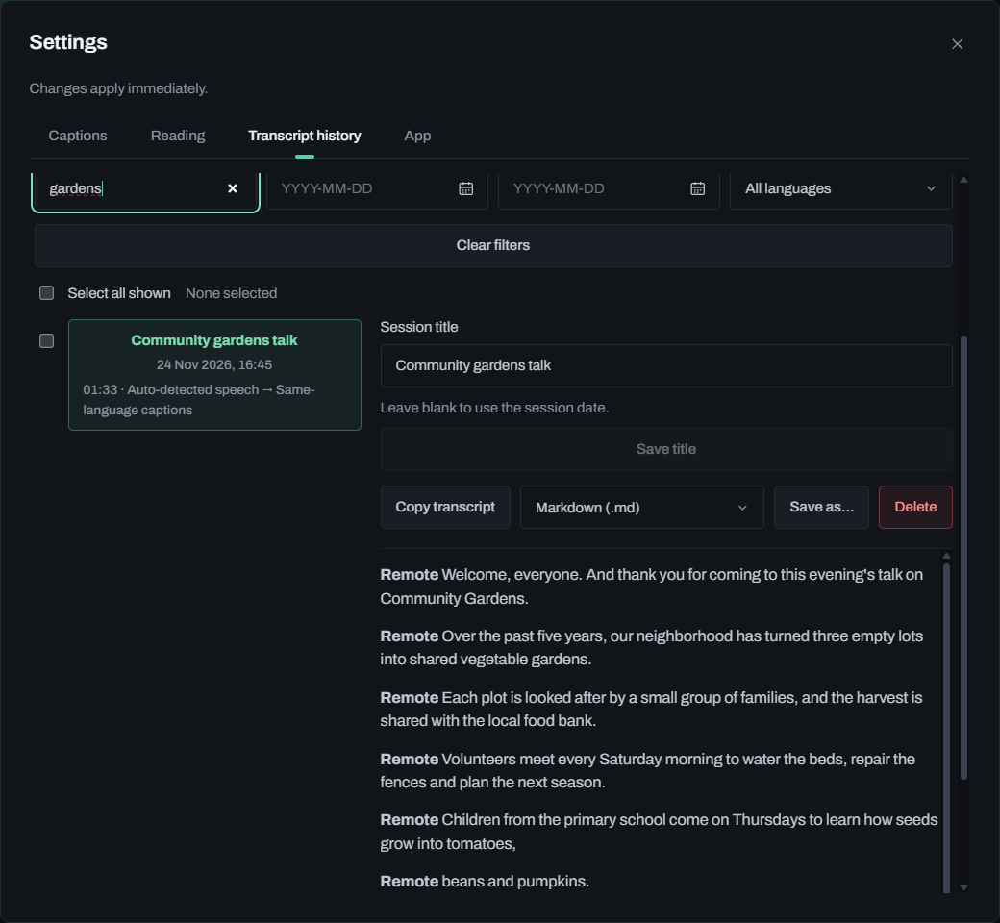

# Transcript history

Automatically save finalised captions locally as you go so you can name, search, reopen, copy and
export past meetings later.

Open **Settings → Transcript history** in the operator window and turn on **Automatically save
sessions locally** before starting a meeting (off by default). Switching it on mid-session saves
finalised lines from that point onward without saving earlier lines retroactively.

Each Start begins a new session file under
`%LOCALAPPDATA%\io.github.fmadore.live-translation\history\<session-id>.json` (or
`~/Library/Application Support/io.github.fmadore.live-translation/history/` on macOS). The first
line writes immediately; after that, new lines flush at most every 5 seconds. Stop, quit, retry
and the next Start flush any pending lines immediately. Stop also drains trailing partial text,
and Whisper keeps writing finalised lines while its backlog finishes—wait for it to complete
before exporting. Pause keeps the same history session. After a crash, the file holds everything
up to the last 5-second flush. Empty sessions create no file.

If every source stops on its own (for example after a provider error), the session ends at that
moment so its recorded duration does not keep ticking. While the History tab is open during a live
session, its list refreshes at most every 5 seconds, while Refresh, rename and delete update
immediately. Each refresh reads only new or grown files; if a file is temporarily locked by backup
or antivirus software, it is skipped and logged while the rest of the list loads normally.

Each row shows start date and time, duration and known language details (two-language sessions
show both, such as `→ FR + DE`). Source speech is marked auto-detected when the engine does not
report a language, and Whisper history records its source language as automatic even when a spoken
language was selected. Unfinished sessions show duration up to the last save. Click any session
to read its raw captions and available source text, copy it, or export it as Markdown, plain text,
WebVTT or SRT via the normal Save As dialog (sharing the toolbar's chosen format). Timed formats
require valid cue timing. Browsing or exporting history never touches your active transcript.

Saved sessions stay on disk after you clear or export the active transcript, quit the app or turn
history off. Use **Delete**, then **Delete permanently**, to remove a session. Deleting the
currently running session stops further writes for that session until the next Start. Unreadable
files are still listed individually so you can delete them.

You can also act on several sessions at once. Tick individual rows or click **Select all shown**
to select every session matching your current search, date and language filters. **Delete
selected** removes them in one confirmed step. **Save selected to a folder…** exports every
selected session in the chosen format using the standard filenames, appending ` (2)`, ` (3)`… to
avoid overwriting existing files. Unreadable sessions—and untimed sessions when SRT or WebVTT is
selected—are skipped and counted. If any file fails, the rest still complete, the summary reports
what failed and why, and failed deletions stay ticked so you can retry.

Files are local, unencrypted text with no automatic expiry and no upload. No audio, API keys,
device names or application identities are saved. History and the single crash-recovery copy are
independent; see the [privacy policy](privacy.md).

## File format

Each session is a single UUID-named JSON Lines file under the app's `history` folder:

1. a header (`version: 2`, ID, start time, mode, languages and title);
2. one `{"line": …}` record per finalised line, oldest first;
3. a progress record (`savedAt`, `durationMs`, `endedAt`) after each write;
4. a `{"title": …}` record for each rename;
5. a `{"marker": {"id", "atMs", "label"}}` record for each transcript marker, timed on the
   session's own clock.

The latest progress and title records win. Older builds skip unknown marker records cleanly, and a
damaged marker record is skipped rather than failing the whole session. The History reader renders
markers as headings and searches their text. The first write (and any write after an error)
replaces the file atomically via a flushed staging file; subsequent writes append only new lines.
Because the log only grows, the History tab sends its cached byte lengths to `list_history` and
decodes only new or grown files (plus any renamed older-format files).

## Verification

Automated tests cover opt-in behaviour, progressive writes, raw text preservation, separate
session timelines, trailing partials, duration finalisation, restart readback, atomic replacement,
interrupted writes, retry, corruption, deletion races, path validation, operator-only permissions
and History UI actions.

Native release checks run the built-in demo with history enabled, restart the packaged app, reopen
two sessions, export and delete one, and confirm the other survives—plus ending a disposable demo
run abruptly to verify its last saved snapshot.

## Titles and search

Saved sessions can be renamed (up to 120 characters; clearing the title restores the date label),
even while a session is still live. Renaming never modifies caption text.

Search matches session titles, caption text, markers and available source text. The language
filter checks the translation target (either target in a two-language session) or known subtitle
language; auto-detected languages stay marked unknown rather than guessed. Filters never delete
sessions or alter exports.

Enter date bounds in year-month-day order or use the calendar button (**YYYY-MM-DD** in English,
**AAAA-MM-JJ** in French, **JJJJ-MM-TT** in German; e.g. `2026-09-20`). Invalid dates display a
localised error without replacing the last valid filter. Both bounds include the full local day.
Clear a field to remove one bound, or click **Clear filters** to reset search, dates and language.
The native calendar popup follows your system's regional format.
