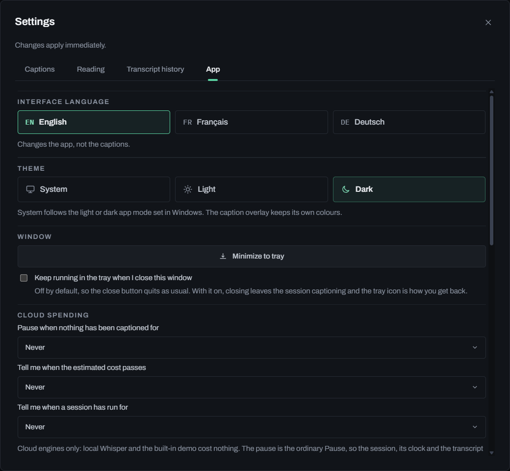

# Meeting controls and profiles

Run a live session smoothly from start to finish: caption a call on loudspeakers once, pause
during breaks, guard cloud spending, save reusable room profiles, display two caption languages, drop transcript markers and control the
overlay from the keyboard.

## Session controls

Start and Stop sit in a persistent action bar right below the app header, staying visible while
either column scrolls—including in the single-column layout at narrow widths or enlarged text
sizes. Rehearse sits beside Start; setup, live captions and the transcript stay below.

Start, Rehearse and Ctrl+Shift+Space share one rule: nothing starts while another start, stop or
profile load is in progress, while the selected caption language is unsupported by the engine, or
before the engine is ready (API key saved, Whisper model installed or demo selected). Start also
requires a chosen application to be running; Rehearse plays the bundled sample instead, and the
built-in demo has no rehearsal.

Fresh installations open on Whisper with Base and automatic language detection. The pre-flight
checklist's Whisper row includes a direct download button showing the model's size
(**Download Base (57 MiB)**) with progress and Cancel, synced with the model step. Switching modes
restores the engine you last used in that mode (`setup.lastEngines` in local storage); without one,
Subtitles defaults to Whisper (or the built-in demo on unsupported processors) and Live
translation defaults to Gemini. Switching modes keeps your audio source without starting capture
or downloading anything, and existing setups carry across upgrades.

## Both sources: headphones or loudspeakers

With **Both** sources, the app captions the room microphone and the computer's sound together:
in a Teams or Zoom call, your own voice comes from the microphone and the other participants
from the system audio. With headphones, the call goes to your ears only, and each person is
captioned once.

On loudspeakers, the microphone also hears the call. The remote speaker is then captioned twice:
once from the system audio, and once from the microphone, as if you had said the same thing.
To prevent this, turn on **Leave out the call heard by the room mic** under the Both tile in
*Where the audio comes from*. Since the app cannot tell headphones from loudspeakers, the
pre-flight checklist also shows a **Loudspeakers?** row under Both, whose **Leave out the call**
button switches the same setting on or off.

With it on, a microphone line whose words repeat what the system audio captioned at the same
moment is left out. Nothing is lost: that line is already on screen from the system audio, and
what you say yourself still appears, since the call does not send your voice back through the
system audio. While the call is sounding, finished microphone lines reach the transcript a few
seconds later (up to about 30 seconds with local Whisper), because each waits to be compared
with the system audio. The comparison is made on the words, so a microphone that hears the call
badly, in a noisy room or at a low volume, can still let a copy through. With headphones, leave
the setting off.

## Pause

**Pause** (beside Stop, or Ctrl+Shift+P) holds the session, clock and transcript together during a
break. Cloud connections close cleanly after flushing their final turn, so no audio is streamed or
billed until you click **Resume**. The running cost estimate counts only streamed time per source,
at each engine's own rate: ended streams stop ticking, and a source switched to offline Whisper
costs nothing from that point on
([local Whisper](local-whisper.md#when-a-cloud-engine-stops-continue-with-whisper)). With
**Whisper**, Pause stops new audio from entering recognition or temporary storage while any queued
speech finishes decoding. The built-in demo pauses between scripted lines.

Audio capture and level meters stay live while paused. **Hide overlay** only hides captions on
screen without pausing capture or cloud billing. Normal Stop lets Whisper finish its backlog; wait
for completion before exporting a full transcript.

### Spending guard for cloud engines

Leaving a cloud session running over lunch bills every open stream. **Settings → App → Cloud
spending** offers three optional guards, each set to **Never** until you enable it
(`guard.idlePauseMinutes`, `guard.costWarningUsd`, `guard.durationWarningHours`):

- **Pause when nothing has been captioned for** 5, 10, 15 or 30 minutes. If no interim or final
  caption arrives from any source during that window, the app pauses the session cleanly so cloud
  connections close and billing stops until you click **Resume**. A banner above the stage explains
  why, with **Resume** and a shortcut to show a break notice on the overlay; resuming by any means
  clears it. It never stops the session or alters the transcript.
- **Tell me when the estimated cost passes** $1–$50, and **when a session has run for** 1–8
  hours: shows a dismissible notice above the stage once per session without stopping captions.

The guard watches cloud engines only, since local Whisper and the demo are free. It checks every
15 seconds on the existing session clock with zero per-caption overhead.

### Notice on the overlay

**Show a notice on the overlay…** (under the overlay controls in the running rail) replaces
captions with a single centred line during a break. Preset phrases (**Captions paused**, **Back
soon**, **Short break**) display immediately in the caption language when supported (English,
French or German) and in the interface language otherwise, or you can type any custom message up
to 80 characters and click **Show notice**. Click **Clear notice** to restore captions. With
**Remove it when captions resume after a pause** enabled (the default,
`overlay.noticeUntilCaptions`), the first caption after a pause clears the notice automatically.
Notices shown while speech is still running (for instance over a video clip) stay until cleared;
stopping the session always clears them.

The notice travels through the existing `OverlayConfig.notice` channel as plain text (capped at
80 characters, never markup), shrinks down to 12 px if needed to fit a shallow strip, and is never
saved to the transcript, sent to Zoom or stored on disk.

## Meeting profiles

Use the profile picker above step 01, then **Manage profiles**. Choose **Save current setup…**,
enter a name and save. Each profile row offers **Load profile** and a management menu for
**Rename** or confirmed deletion. Each save creates a named snapshot.
Profiles persist locally across restarts, using `meeting.profiles` in webview local storage.

A profile includes output mode, provider, caption language, audio source and device identifiers,
caption appearance, reading pace, hold time, cleanup toggle and the current overlay rectangle.
It excludes API keys, rehearsal mode, transcripts and application process identities. Loading
does not start capture or change the opt-in history and recovery preferences.

Loading is disabled during capture, an audio test or another setup operation. The app enumerates
devices before applying the profile. Missing endpoints fall back to the Windows default with a
notice; application capture remains unselected until the operator explicitly selects a process.
The pre-flight must be checked again. A saved overlay rectangle is constrained to an available
display's work area; a disconnected projector falls back to the primary display. Check placement
after display or scaling changes. Only the operator window may invoke the placement commands.
A loaded profile's rectangle also becomes the overlay's remembered placement for the current
displays, which the next launch reopens without loading the profile again
([caption layout](caption-layout.md#fit-window)).

## Reading and saved sessions

### Two caption languages and original speech

In **Live translation**, choose your first target in the language step, then use **Second
caption language** for an additional target supported by the same engine. The two targets
must differ. Choose no second language to return to a single output. Both captions appear
in the overlay and transcript; exports preserve each line's language. Each target opens a
separate provider session for each audio source, so adding a target increases cloud usage.
The pre-flight cost row and the running rail both mark the rate **×2 sources** and
**×2 languages** where each applies.

In **Settings → Reading**, **Show the original speech under translations** adds a smaller
source-text line when the provider supplies one. It works in Fit window and Compact, not
Stable reading. This display choice is separate from **Include original speech** in the
export controls. Neither option creates missing source text. Local Whisper transcribes in
the spoken language and does not offer translation targets.

### Settings and history

Settings has **Captions**, **Reading**, **Transcript history** and **App** tabs. **App** also
holds the [spending guard](#spending-guard-for-cloud-engines).
The dialog and tab bar retain their dimensions when switching tabs; the content scrolls
independently and starts at the top of each newly selected tab. Short tabs intentionally
leave spare space. Use the Left and Right arrows, Home or End within the tab bar, and Tab to
reach its content. Settings opens with focus on its selected tab, not on the corner button.
Changes apply immediately; close with the corner button or Escape. Until a session has been
saved, **Transcript history** shows only its opt-ins and one sentence; the search, the date and
language filters and the session reader appear with the first saved session.

See [caption layout](caption-layout.md#reading-pace-and-preview) for the adjustable reading pause,
Steadier updates and presets. See [transcript history](transcript-history.md#titles-and-search)
for session titles, full-text search and inclusive date and language filters.

## Input status

The running rail describes each active source independently. Connection, reconnection and error
states take precedence. A recent caption is shown as **Receiving captions**; otherwise a recent
level above the existing RMS signal threshold is **Receiving audio**. When audio is arriving
but captions have not arrived for 15 seconds, the app suggests checking the provider or the connection.
Quiet inputs say **Listening — no recent audio signal**. These are observations, not speech
detection or a diagnosis of provider failure. The built-in demo uses simulated input events.
A screen reader hears a source only when it stops with an error or goes 15 seconds without
captions, not on every change of label.

## Keyboard controls

These shortcuts apply while the operator window has focus, outside inputs, selects, editable
text and dialogs. Repeated keydown and IME composition do not trigger commands. They are not
system-wide hotkeys and cannot control the app while another application is focused; two of
them have an opt-in system-wide twin ([below](#system-wide-pause-and-overlay-keys)).

| Shortcut | Action |
| --- | --- |
| Ctrl+Shift+Space | Start / stop; follows the same rule as Start, and says why when an unsupported language or a missing application stops it |
| Ctrl+Shift+P | Pause / resume a running session |
| Ctrl+Shift+O | Show / hide the overlay |
| Ctrl+Shift+Up / Down | Increase / decrease caption size |
| F2 | Switch translation direction while stopped |
| Ctrl+Shift+M | Add a marker to the transcript while captioning |
| Ctrl+F | Find in the transcript, on the stage's Transcript tab |

Shortcut help lives in **Settings → App**. A shortcut hint sits beside Start. Existing overlay
move-mode keys are unchanged. On a Mac each Ctrl is ⌘ (⇧⌘M, ⌘F). Ctrl+F is taken from the
webview: the browser's own find bar never opens in the app's place, and outside the
Transcript tab the key does nothing.

### System-wide Pause and overlay keys

A presenter running slides full screen on the same computer cannot reach the window's
shortcuts without switching to it. **Settings → App → Use shortcuts while other apps are in
front** (off by default, kept in webview storage like *Keep running in the tray*) adds two
system-wide keys:

| Shortcut | macOS | Action |
| --- | --- | --- |
| Ctrl+Alt+Shift+P | ⌃⌥⇧P | Pause / resume captions |
| Ctrl+Alt+Shift+O | ⌃⌥⇧O | Show / hide the overlay |

- **No Start or Stop key.** A stray press must not start a billable session or end a meeting's
  transcript.
- **Held only while a session is running or paused.** An idle app holds no system-wide key,
  so another application can have the combination; the keys are released on Stop, when the
  switch goes off and when the app quits.
- **The same action as the window's key, button and tray entry.** A press goes to the
  operator window as a tray command and runs the same function, under the same conditions
  (Pause only while a session runs and no start or stop is under way), so Pause/Resume, the
  overlay toggle and the tray menu all follow. Holding the keys acts once: Windows is asked for
  no auto-repeat, and presses less than 400 ms apart count as one.
- **Why these keys.** The window's own P and O, with Alt (Option) added, and Control rather
  than Command on a Mac. Ctrl+Shift+P opens a private browser window and ⇧⌘P is taken in many Mac
  apps; PowerPoint, Keynote, Zoom, Teams and the browsers leave Ctrl+Alt+Shift and ⌃⌥⇧ alone.
  Ctrl+Alt is AltGr on some keyboard layouts: where AltGr+Shift+P or O types a character (the
  Polish layout's Ó, for one), it cannot be typed while a session runs with the switch on.
  The keys are fixed in this version.
- **When another app has the combination**, nothing else is affected: the other key still
  works, the window's own shortcuts still work, and the Settings row says which combination
  could not be registered, in a status region. On a Mac the system may accept a combination
  another app also uses, so a clash is not always reported there.

## Markers and find in the transcript

**Add marker**, in the transcript's toolbar while a session runs (or Ctrl+Shift+M), opens a
one-line field under the toolbar: type a talk's start or a speaker's name (up to 80
characters) and press Enter, or leave it blank for a numbered section break (**Section 2**).
Escape puts the field away; either way focus goes back to where it was. The marker is placed at
the session's time, between the paragraphs on either side of it; it is drawn as a heading in
the log, so a screen reader can move from one talk to the next, and a status says it was added.
Markers make the transcript unsaved, are written into plain text, Markdown and WebVTT exports (see
[transcript export](transcript-export.md#markers)), and are kept in the recovery copy and the
session history when those are on, even before the first caption. SubRip omits markers. They are never shown on the overlay or sent to Zoom.

**Find** (or Ctrl+F), on the stage's **Transcript** tab, opens a field over the log with the
match count (**2 of 7**), previous and next (Enter, Shift+Enter) and close (Escape, which hands
focus back to where it was). Matching is History's search: case and compatibility forms are
ignored, so *café* finds *CAFÉ* and an accent typed apart. Captions, the original speech when
it is shown, and marker titles are searched. Matches are highlighted with the CSS Custom
Highlight API, which adds no element to the text, so selecting and copying are as before; past
a thousand matches only the current one is highlighted, though all are counted. While find is
open, new captions do not move the log, so the current match stays where it is being read.

The search runs 150 ms after typing stops and again when the log gains a line or a marker,
never per caption delta: the turns still being spoken are found once they are final. Each
paragraph's folded text is kept while the paragraph is unchanged, so a 4,000-line log costs one
pass the first time and a lookup per paragraph after that.

## Verification

Automated tests cover interim batching without starvation, independent sources, immediate
finalization, stop cancellation, preference validation, profile round trips and hardware checks,
profile controls, safe placement, the placement remembered per display layout (its signature,
saving, the eight-layout cap and the launch restore), concurrent history renames, search,
keyboard guards and live status classification. Gemini tests cover final/interim
precedence, empty finals and a segment that ends without a final.
German date regressions cover valid and invalid dates, leap years, calendar event handling,
inclusive bounds and filter reset.

Impeccable browser checks on 19 September 2026 used the real components with a temporary
synthetic backend at 1280×800 and 800×600, in French and German and at 200% text scaling:
appearance previews, the Large room preset, profile save/load, history search and title
editing, input statuses, the stop shortcut and the two-source stable overlay at 1000×400. On
20 September, Settings kept identical dialog and tab-bar positions across all four tabs at
1280×800 and in a narrow preview. Browser checks do not exercise native storage, the native
calendar popup, installed MSIX behaviour or cloud services; native mixed-DPI placement,
keyboard operation in the packaged app and a fresh paid provider probe still require release
acceptance.
